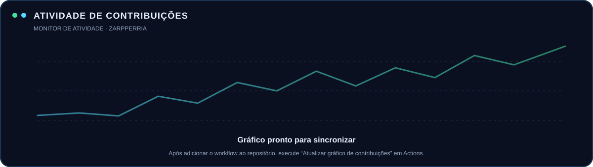

 

---

<table>
<tr>
<td width="62%" valign="top">

## 👋 Olá, eu sou o Iuri

Sou formado em **Ciência da Computação**, criador de conteúdo por trás da **Zarpperia** e apaixonado por tecnologia. Uso este espaço para desenvolver projetos, explorar ideias e compartilhar minha evolução como desenvolvedor.

- 🧠 **Interesses:** inteligência artificial, automação e software.
- 💻 **Desenvolvimento:** programação, estruturas de dados e aplicações.
- 🔬 **Abordagem:** aprender na prática, testar e melhorar continuamente.
- 🎮 **Também curto:** games, comunidades e criação de conteúdo.

</td>
<td width="38%" valign="top">

## ◈ Meu foco

  

  

</td>
</tr>
</table>

## ⚙️ Stack & ferramentas

  

## 🚀 Projetos em destaque

<table>
<tr>
<td width="50%" valign="top">

### 🧠 [ZarpperiaEvolutiva](https://github.com/Zarpperia/ZarpperiaEvolutiva)

Projetos e experimentos de inteligência artificial e desenvolvimento.

</td>
<td width="50%" valign="top">

### 📱 [JudasFit](https://github.com/Zarpperia/JudasFit)

Projeto de software com foco na construção de funcionalidades práticas.

</td>
</tr>
<tr>
<td width="50%" valign="top">

### 🌳 [JavaAvoreBinaria](https://github.com/Zarpperia/JavaAvoreBinaria)

Prática de estruturas de dados e árvores binárias em Java.

</td>
<td width="50%" valign="top">

### ⚙️ [Fabrica](https://github.com/Zarpperia/Fabrica)

Mais um espaço de experimentação e aprendizado com código.

</td>
</tr>
</table>

## 📊 GitHub analytics

  

  

Gráfico gerado no próprio repositório e atualizado diariamente pelo GitHub Actions.

## 🤝 Vamos nos conectar?

  

Construído com curiosidade, consistência e vontade de evoluir. · <b>Zarpperia © Iuri Santos</b>

